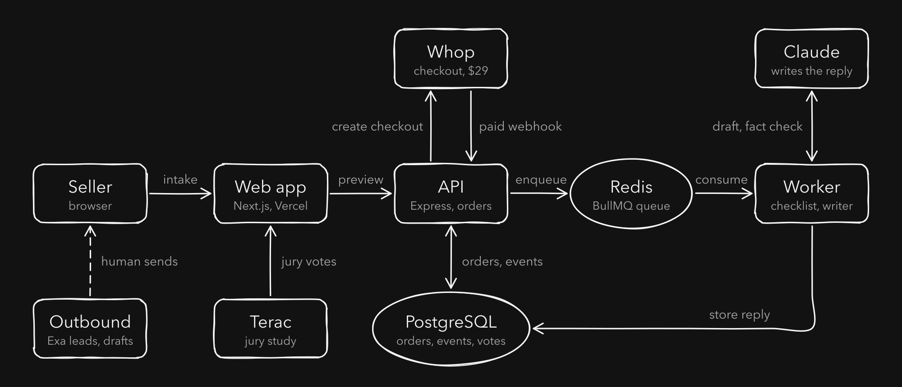

# Receipts

Chargeback replies for sellers of digital goods. A seller describes one dispute, sees a free preview of whether it is winnable, and pays $29 for a written reply to the bank.



## How it flows

1. **Intake and preview.** The seller fills the intake in the web app. The API runs a deterministic proof checklist and returns a free preview: dispute, escalate, or accept. No LLM is involved at this step. Only winnable previews offer a checkout.
2. **Checkout.** The API creates a Whop checkout and the seller pays on Whop's hosted page.
3. **Paid webhook.** Whop sends `payment.succeeded`. The API verifies the signature, marks the order paid and enqueues one job per order, so a duplicate webhook never fulfills twice.
4. **Fulfillment.** A BullMQ worker re-runs the checklist, has Claude write the reply from the checklist items only, fact checks every figure, id and date, then stores the result in Postgres.
5. **Results.** The web app polls the order by token and shows the reply once it is fulfilled. Every step writes an `AgentEvent`, visible on `/trail`.

Two side flows share the same Postgres:

- **Jury study.** Terac participants vote on v0 and v1 replies through the web app's jury page, to measure whether the checklist-backed replies win more often.
- **Outbound.** An agent finds leads with Exa and drafts emails. A person reviews and sends each one, nothing is sent from code.

## Repo layout

```
apps/api       Express api, BullMQ worker, Prisma schema
apps/web       Next.js app: landing, intake, results, jury, trail
packages/shared  zod schemas shared by api and web
docs           feature specs (F0 to F5a) and the v0 vs v1 comparison
```

## Run locally

```bash
docker compose up -d                      # postgres and redis
pnpm install
pnpm --filter @receipts/api dev           # api
pnpm --filter @receipts/api worker        # fulfillment worker
pnpm --filter @receipts/web dev           # web
```

Copy `apps/api/.env.example` and `apps/web/.env.example` first. Use Whop sandbox keys and test cards only.
